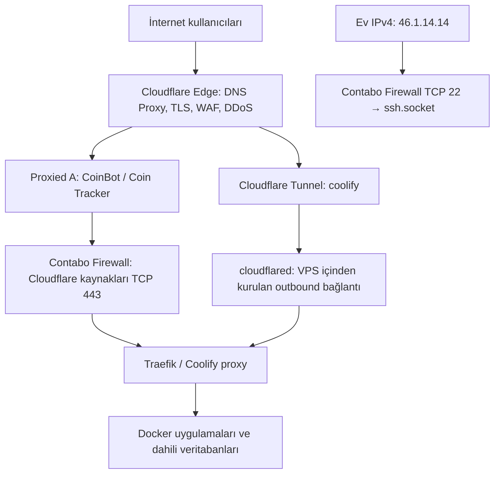

# Sunucu envanteri, mimari ve DNS

Contabo VPS envanteri (26.11.2026 referans değerleri), mantıksal mimari, Cloudflare DNS kayıtları ve katman farkları.

Belge indeksi: [README.md](README.md) · Kaynak bölüm numaraları korunmuştur (bkz. indeksteki harita).

## 2. Sunucu envanteri

| Bileşen | Bilinen değer (26.11.2026) |
|---|---|
| Sağlayıcı | Contabo VPS |
| Hostname | `vmi3767355` |
| Public IPv4 | `156.67.103.212` |
| Public IPv6 | `2a02:c207:2376:7355::1` |
| Ağ arayüzü | `eth0` |
| İşletim sistemi | Ubuntu 24.04.5 LTS |
| Kernel (eski → yeni) | `6.8.0-149-generic` → `6.8.0-151-generic` |
| SSH / sudo kullanıcısı | `mertpc` |
| Yetkili ev IPv4 | `46.1.14.14/32` (statik olduğu doğrulanmadı) |
| RAM | Yaklaşık 11 GiB kullanılabilir toplam bellek (`free -h`) |
| Disk | 193 GiB root filesystem, 7.2 GiB kullanım, %4 (bakım öncesi) |
| Swap | Yok; bakım sırasında acil kapasite sorunu gözlenmedi |
| Docker Engine | 29.10.0 → 29.10.1 |
| Docker Buildx | 0.39.0 → 0.39.1 |
| Cloudflared | 2026.11.1 → 2026.11.2 |
| Systemd | 255.4-1ubuntu8.18 → 255.4-1ubuntu8.19 |
| Coolify | `coollabsio/coolify:4.7.6` |
| Traefik | `traefik:v3.7` |
| Coolify Sentinel | `coollabsio/sentinel:1.1.5` |
| PostgreSQL | Uygulamalar: 17-alpine; Coolify: 15-alpine |
| Redis | 7-alpine |
| CouchDB | 3.4.2 |
| Cloudflare zone | `zimastack.com`, Free plan |
| Sunucu saat dilimi | Komut çıktılarında CET; Türkiye saati ile aynı değil |

Sürümler bir sonraki bakım için karşılaştırma referansıdır; güncel sürümlerin daima bunlar olacağı varsayılmamalı. Container image güncellemesi ile host Docker Engine güncellemesi ayrı işlemlerdir. Ubuntu 26.04.1 LTS yükseltme bildirimi görüldü ancak geçiş yapılmadı; planlı ayrı bir major upgrade olarak değerlendirilecek.

## 3. Mimari ve Cloudflare DNS

Şema mantıksal mimariyi gösterir; tunnel origin URL'leri ve Access politika ayrıntıları ayrıca dışa aktarılmadı.

### 3.1 DNS kayıtları

| Hostname | Tür / hedef | Proxy | Fonksiyon |
|---|---|---|---|
| `coinbot.zimastack.com` | A → `156.67.103.212` | Proxied (turuncu bulut) | CoinBot uygulaması/API |
| `coin-tracker.zimastack.com` | A → `156.67.103.212` | Proxied | Coin Tracker uygulaması/API |
| `admin.zimastack.com` | Tunnel `coolify` (agent: tunnel CNAME) | Proxied | Coolify yönetim paneli |
| `notes.zimastack.com` | Tunnel `coolify` (agent: tunnel CNAME) | Proxied | Obsidian LiveSync / CouchDB |

Cloudflare DNS ekranında 4/200 kayıt kullanıldığı görüldü. Eski `coinbot-test.zimastack.com` loglarda bulunuyor fakat güncel DNS listesinde yok. Eski test domainini tekrar ekleme.

Nameserver'lar:

- `eve.ns.cloudflare.com`
- `finley.ns.cloudflare.com`

**Yeni servis ekleme:** Coolify'da uygulamayı oluştur, internal portunu reverse proxy'ye tanıt, uygun proxied A kaydı veya tunnel hostname ekle, TLS ve WAF kapsamını kontrol et. DB veya uygulama portunu host'a publish etme. Public bir API'yi Access arkasına almanın API istemcilerini bozabileceğini değerlendir. Sırf bir servis için Contabo'da yeni inbound port açmak normalde gerekli değil.

### 3.2 Katmanların farkı

| Katman | Görev |
|---|---|
| Contabo Firewall | Ağ/transport katmanı: IP, protokol ve port kısıtlaması |
| SSH | Anahtar bazlı yönetim erişimi |
| Cloudflare DNS | Hostname çözümleme; proxied kayıtlarda Cloudflare edge'e yönlendirme |
| Cloudflare WAF | HTTP(S) isteklerini imza/koşul bazında filtreleme |
| Cloudflare Access | Uygulama önünde kullanıcı kimlik doğrulama ve yetkilendirme |
| Cloudflare Tunnel | VPS'ten outbound bağlantıyla origin'e erişim; tek başına kimlik doğrulama değil |
| Traefik | Hostname bazlı reverse proxy, TLS, routing ve access log |
| Docker | Uygulamaların ve veritabanlarının ağ izolasyonu |
| DNSSEC | DNS yanıtlarının imza ve güven zinciriyle doğrulanması; trafik şifreleme veya WAF değildir |

DNS Only (gri bulut) kayıtları Cloudflare HTTP WAF korumasından geçmez. Cloudflare source IP allowlist, origin IP'yi gizli veya her türlü bypass'a karşı bağışık hale getirmez. İhtiyaç halinde origin kimlik doğrulaması/tunnel mimarisi ayrıca değerlendirilir.
